# OBMS — System Architecture

Organizational Bid Management System (מערכת לניהול מכרזים). A Hebrew (RTL) web application on Firebase
(project `biding-system`) that takes a tender from a requester's first request, through AI-assisted
drafting, internal review and approval, publication to suppliers, Q&A, proposal intake and AI-assisted
evaluation, to award, with an append-only audit trail.

| | |
|---|---|
| **Document status** | Derived from the code on branch `feat/single-tender` (2026-11-04). Not verified against the live Firebase project. |
| **Related** | [SPEC.md](../SPEC.md) (requirements, partly stale, see §14), [RUNNING.md](../RUNNING.md), [skills/](../skills/) (AI rules), [docs/superpowers/](superpowers/) (feature designs) |

> **Items marked `❓ FIREBASE`** are things the repo cannot answer (live configuration and deployed state).
> They are collected in the checklist in [§15](#15-open-items-to-complete-from-the-firebase-console).

---

## 1. Principles that shape the design

| # | Principle | Where it is enforced |
|---|---|---|
| P1 | **The client never writes privileged data.** Firestore rules are default-deny; every state change is a callable Cloud Function using the Admin SDK. | `firestore.rules`, `functions/src/index.ts` |
| P2 | **One writer for tender status.** `transition()` validates the FSM, persists, and audits. | `functions/src/stateMachines/tenderFsm.ts`, `shared/src/tender.ts` |
| P3 | **AI is called only server-side and is always non-binding.** A human decides. No key, emulator, or failure falls back to a labelled deterministic path. | `services/aiService.ts` |
| P4 | **Suppliers are isolated.** They see only tenders shared with them, only their own submission, anonymous Q&A, and never a Google Docs link. | rules `exists(access/{supplierId})`, `getTenderDocument` |
| P5 | **Strict case teams.** A non-manager internal user sees only cases where they hold a team slot (`memberUids`). | `isCaseMember()` in rules, `requireCaseAccess` |
| P6 | **A supervisor gate before suppliers see anything.** Deterministic checks plus a Claude review whose findings must quote the document verbatim. A BLOCK stops publication unless a manager overrides with an audited reason. | `services/supervisor*.ts` |
| P7 | **Shared contract.** Types, Zod schemas, FSM tables and pure business rules live in one package used by web and functions. | `shared/` |

---

## 2. System context

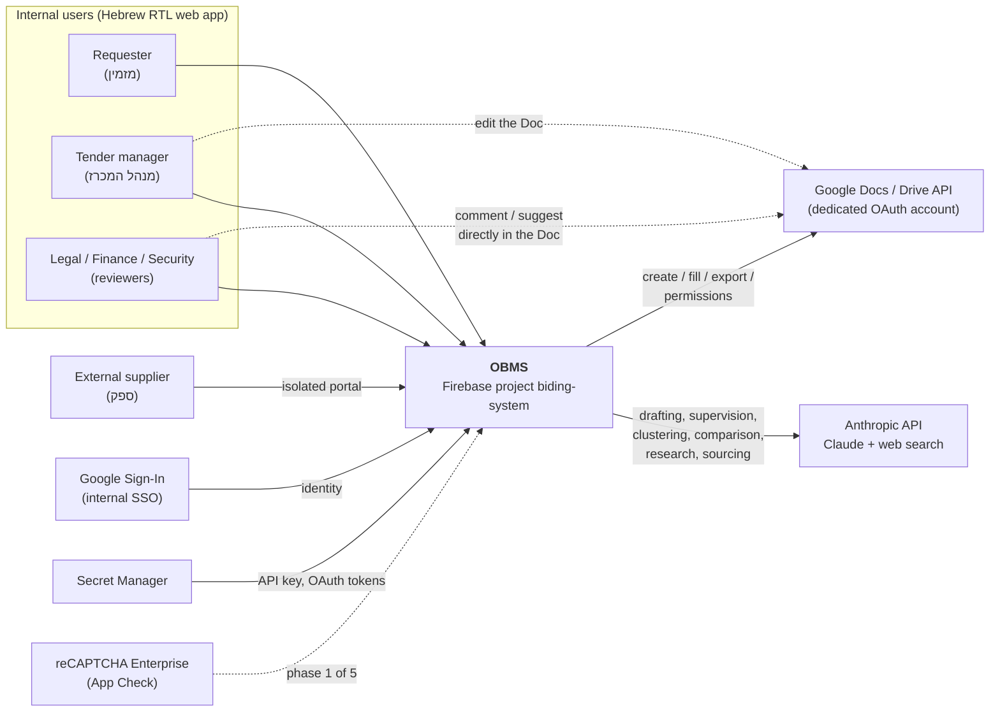

Suppliers never reach Google Docs. They read a system-rendered copy through `getTenderDocument`.

---

## 3. Container view (what runs where)

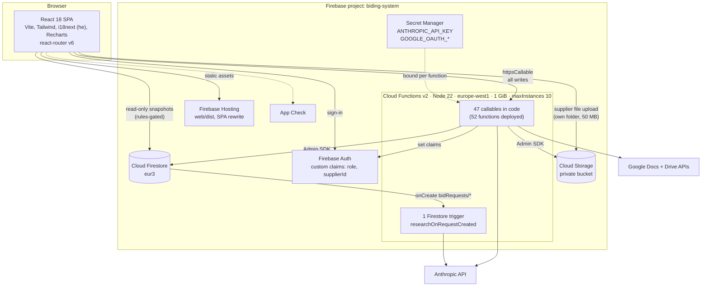

### Repository layout (npm workspaces, build order `shared → functions → web`)

| Path | Role |
|---|---|
| `shared/` | `@obms/shared`: TS types, Zod schemas, FSM, team and score rules, field catalogs, pure helpers. Used by web and functions. |
| `functions/` | Cloud Functions. `src/index.ts` (callables), `repositories.ts` (Firestore access), `services/` (AI, docs, supervisor, score, feedback, research), `stateMachines/`, `lib/`. Bundled with esbuild into `lib/index.js` with `@obms/shared` inlined. |
| `web/` | React SPA. `pages/`, `components/`, `layouts/`, `lib/` (Firebase singleton, hooks, API wrappers), `i18n/he.json`. |
| `skills/` | Markdown rules for the AI: `00_GLOBAL_RULES.md` (G1–G11), `01_ORCHESTRATOR.md`, and 20 skills `s01…s20`. Copied into `functions/skills` by the `prebuild` step. |
| `firestore.rules`, `storage.rules`, `firestore.indexes.json`, `firebase.json` | Security and infrastructure config. |
| `index.html`, `supplier.html`, `assets/`, `data/` | The original **static HTML prototype**. Superseded by the Firebase app, kept for reference. |
| `docs/superpowers/` | Per-feature specs and plans. |

---

## 4. Roles and authorization

Six roles, carried as Firebase Auth **custom claims** (`role`, plus `supplierId` for suppliers) and mirrored in `users/{uid}`. Claims are set only by Cloud Functions.

| Role | Kind | Can do |
|---|---|---|
| `tender_manager` | internal, super-user | Everything: create cases, edit the document, manage the team, transition, publish, award, administer users, suppliers and templates. Sees all cases. |
| `requester` | internal | Open requests (phase 1). Reviewer on cases where assigned. |
| `legal`, `finance`, `security` | internal reviewers | Comment and suggest on the document, approve, chat. Only on cases where assigned. |
| `supplier` | external | Portal: published tenders shared with them, ask questions, submit a proposal. |

Three enforcement layers, each independent:

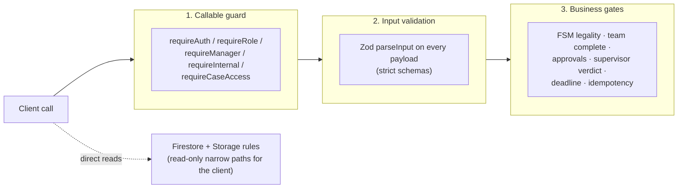

Rules worth knowing (`firestore.rules`):

- A supplier's access to a tender is proven by the **existence** of `tenders/{id}/access/{supplierId}`, and the tender doc is only readable in `published | responses | evaluated | awarded`.
- `questions/*` hold **no identity**. The asker is in `questionAuthors/*`, which a supplier can read only for their own question. Client creation of questions is denied.
- `submissions/{supplierId}`: a supplier can create or update only their own, and can never change `status`.
- The only client writes anywhere: the case **chat** (immutable, server-timestamped, identity enforced), `chatReads/{uid}`, and the supplier's own submission metadata.
- `collectionGroup('access')` and `('submissions')` have their own `/{path=**}/…` rules plus a COLLECTION_GROUP index on `access.principalId`.
- Storage: only `tenders/{id}/submissions/{supplierId}/*` is client-accessible (owner supplier, plus manager read). Everything else is function-only.

---

## 5. Business process

### 5.1 Two-phase creation, then the tender lifecycle

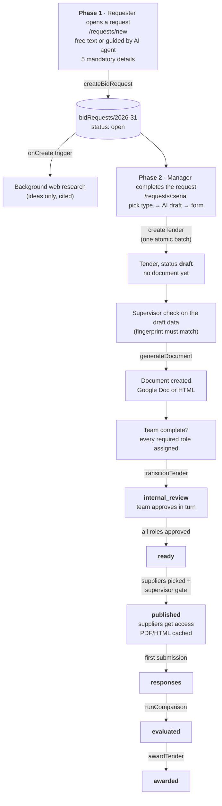

### 5.2 Tender state machine

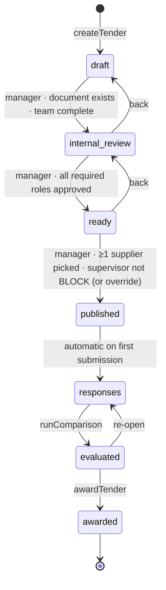

Required roles per type (`shared/src/team.ts`): **goods** = requester, legal, finance; **service** and **project** = requester, legal, finance, security. The manager can add roles, never remove the defaults. `REQUIRE_APPROVALS` is `true` in the code at this commit.

### 5.3 Bid number

`[year]-[n]`, e.g. `2026-31`. `n` is random 1–999, no leading zeros; the year is the **Israel-time** year. The number is the document id of `bidRequests/{serial}`, so uniqueness is guaranteed by `create()`. On collision the allocator redraws; at 999 used it fails with a Hebrew error. Older cases keep `BID-YYYY-NNNN`.

---

## 6. Key sequences

### 6.1 Request → case (idempotent, atomic)

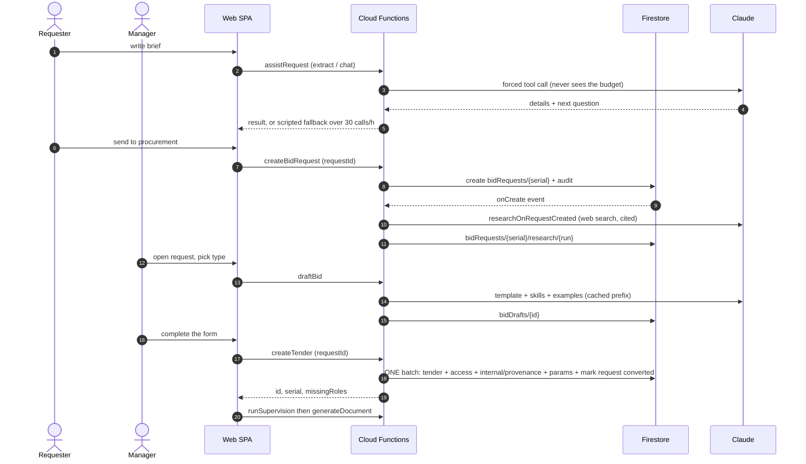

### 6.2 Publish gate

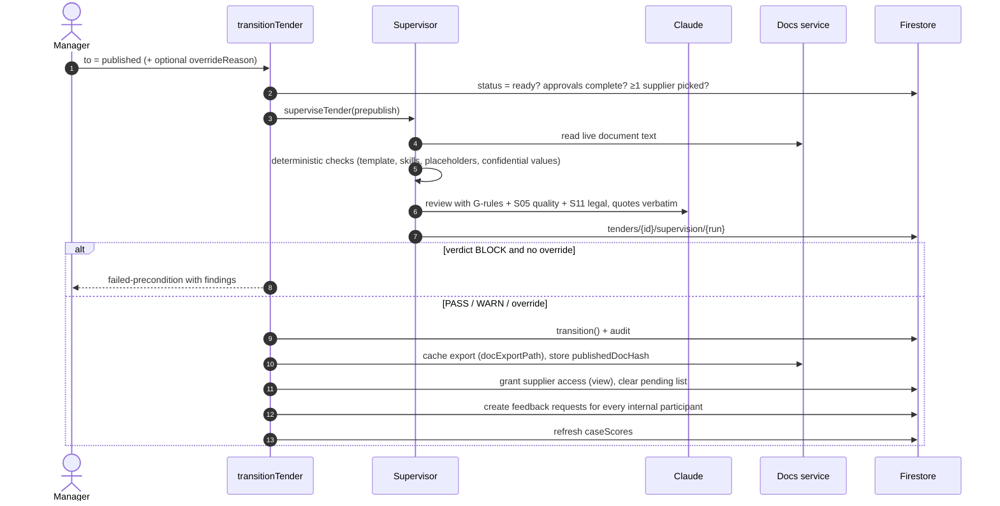

### 6.3 Supplier participation

```mermaid
sequenceDiagram
    autonumber
    actor SP as Supplier
    participant W as Portal
    participant F as Functions
    participant DB as Firestore
    participant ST as Storage
    actor MG as Manager

    SP->>W: open /portal
    W->>DB: collectionGroup(access) where principalId == me
    SP->>W: open tender
    W->>F: getTenderDocument (access doc + visible status checked)
    F-->>W: rendered HTML or base64 PDF, never a Docs link
    SP->>W: ask question
    W->>F: askQuestion
    F->>DB: batch: questions (anonymous) + questionAuthors (identity) + audit
    MG->>F: clusterTenderQuestions (AI sees only id + text)
    MG->>F: answerQuestions (one answer per cluster)
    SP->>ST: upload files to submissions/{myId}/
    SP->>W: save
    W->>F: saveSubmission (rejects after deadline)
    F->>DB: submissions/{supplierId}; first one moves published → responses
    MG->>F: runComparison (summaries + rubric)
    F->>DB: comparisonReport (non-binding)
    MG->>F: awardTender (any supplier)
```

---

## 7. Backend components

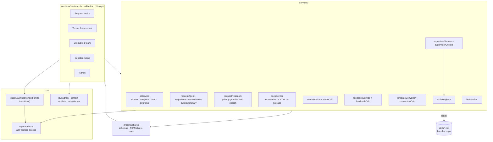

### Callable catalog (by area)

| Area | Callables | Caller |
|---|---|---|
| **Request intake** | `createBidRequest`, `assistRequest`, `requestRecommendations`, `researchDraftRequest`, `rerunRequestResearch`; trigger `researchOnRequestCreated` | requester / manager (rerun: owner or manager) |
| **Tender & document** | `draftBid`, `createTender`, `updateTenderDraft`, `generateDocument`, `regenerateDocument`, `refreshTenderDocument`, `getTenderDocument` | manager (`getTenderDocument`: any authorized caller) |
| **Lifecycle & team** | `transitionTender`, `runSupervision`, `assignTeamMember`, `setRequiredRoles`, `approveTender`, `setPendingSuppliers`, `grantAccess` | manager (`approveTender`: assigned team member) |
| **Supplier-facing** | `askQuestion`, `saveSubmission` | supplier |
| **Evaluation** | `clusterTenderQuestions`, `answerQuestions`, `runComparison`, `awardTender`, `searchSuppliers` | manager |
| **Quality loop** | `recomputeCaseScore`, `backfillCaseScores`, `updateScoringTargets`, `submitFeedback`, `declineFeedback`, `generateSkillTips`, `getSkillsCatalog` | participants / manager |
| **Templates** | `bindTemplateGoogleDoc`, `createTemplateDoc`, `syncTemplateFields`, `analyzeTemplateFields`, `applyTemplateConversion`, `updateTemplateMeta`, `setTemplateInternalFields` | manager |
| **Users & suppliers** | `setUserRole`, `createInternalUser`, `deleteInternalUser`, `upsertSupplier`, `createSupplierAccount` | manager |
| **Maintenance** | `backfillSerials`, `migrateTeams` | manager (one-off) |

Longer timeouts: AI-heavy callables 300 s, research and template analysis 540 s. Global: `europe-west1`, 1 GiB, `maxInstances: 10`.

### Cross-cutting behaviour

- **Idempotency.** `createBidRequest` and `createTender` take a client `requestId`; a retry returns the existing result (`caseCreationRepo`, `byClientRequestId`).
- **All-or-nothing creation.** `createTender` validates everything first, then commits tender, access, provenance, internal params and the request marker in one Firestore transaction/batch.
- **Draft-first.** The case exists as data before any document. `documentGate` requires the latest supervisor check to cover the **exact current data** (`draftDataHash`) with no BLOCK. Editing the draft invalidates earlier checks.
- **Rate limiting.** Per-user hourly buckets in `agentUsage/{uid}[__bucket]`, taken in a transaction: 30 calls/h for the request agent and recommendations (script fallback beyond that), 5/h for web research (hard error).
- **Audit.** Every privileged action appends to `auditLog` through `auditRepo.append`.
- **Hermetic emulator.** `getClient()` returns null and `docsService.realMode()` is false under the emulator unless explicitly overridden.

---

## 8. AI usage

All calls go through `services/aiService.ts` (`getClient`, `toolInput`). Structured output uses forced tool use. `toolInput` **rejects `stop_reason: max_tokens`** so truncation can never silently drop fields.

| Capability | Function / service | Model env var | Fallback |
|---|---|---|---|
| Request assistant (extract, ask next) | `requestAgent` | `ANTHROPIC_AGENT_MODEL` | deterministic script |
| Request recommendations | `requestRecommendations` | `ANTHROPIC_AGENT_MODEL` | fixed suggestions |
| Public service summary | `publicSummary` | `ANTHROPIC_AGENT_MODEL` | none (text is rewritten for suppliers) |
| Requirement research | `requestResearch` | `ANTHROPIC_COMPARE_MODEL` | skipped, `research.status` records failure |
| Bid draft from brief | `draftBid` → `draftBidContent` | `ANTHROPIC_COMPARE_MODEL` | labelled fallback |
| Supervision review | `supervisorService` | `ANTHROPIC_SUPERVISOR_MODEL`, defaults to compare model | **BLOCK in production** if the AI layer fails; WARN under emulator |
| Question clustering | `clusterTenderQuestions` | `ANTHROPIC_CLUSTER_MODEL` (default `claude-sonnet-4-6`) | local heuristic |
| Proposal comparison | `runComparison` | `ANTHROPIC_COMPARE_MODEL` (default `claude-opus-4-8`) | labelled stub report |
| External supplier sourcing | `suggestExternalSuppliers` | compare model | none |
| Template conversion | `templateConverter` | compare model | none |
| Skill-improvement tips | `feedbackService` | compare model | none |

**Guardrails**

- **Skills.** 20 Markdown skills (`s01`–`s20`) plus global rules G1–G11 and an orchestrator define the bid-writing process. Each tender's provenance records which template hash, AI model, skills and edited fields produced it.
- **Grounding.** The supervisor's AI findings must quote the document verbatim; research suggestions must cite a page the search returned.
- **Privacy in research.** A generic search profile is built from the brief, and a fixed guard refuses queries carrying organisation, unit, classification, numbers, URLs or the bid number.
- **Confidentiality.** The budget (`annual_budget`) is never sent to the request agent (strict schema). Confidential params are stored separately in `tenders/{id}/internal/params`.
- **Prompt caching.** Template, skill file and examples form a cache-controlled prefix.

---

## 9. Documents

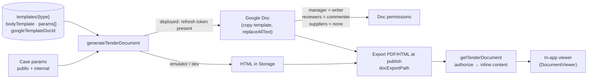

- **Template fields** are `{{placeholder}}` tokens (Unicode, so Hebrew keys work), detected into `params[]`, which drive the dynamic form. A template still containing Word-style blanks (`XXXX`, `____`) must be converted before use.
- **System-filled fields** (bid number, guarantee amount in words, weekday of submission, manager contact, fixed texts) are resolved server-side. Unfilled placeholders stay visible as `{{key}}` so a gap is never hidden.
- **Only the manager accepts changes**: Docs `writer` for the manager, `commenter` for the rest. Reviewers suggest, they cannot accept.
- **Versions** are snapshotted at checkpoints (`tenders/{id}/internal/versions`) and feed the document-change score.
- A `templates/{type}` document is size-guarded to 900 KB against Firestore's 1 MiB limit.

---

## 10. Data model (Firestore)

Timestamps are epoch milliseconds (numbers). Exceptions: chat `createdAt` / `chatReads.lastReadAt` use server timestamps enforced by rules. All validated with Zod in `shared/src/schemas.ts`.

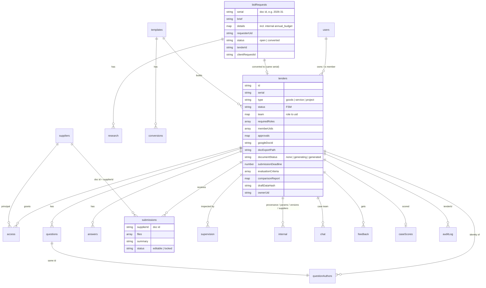

### Collections at a glance

| Path | Purpose | Client read | Client write |
|---|---|---|---|
| `users/{uid}` | profile, role, `googleEmail`, `supplierId` | self, manager | no |
| `suppliers/{id}` | supplier master data | internal; supplier own | no |
| `templates/{type}` (+ `conversions/*`) | per-type template, params, skill, examples | internal (conversions: manager) | no |
| `bidRequests/{serial}` (+ `research/*`) | phase-1 requests | owner, manager | no |
| `tenders/{id}` | the case | manager, team member, shared supplier (published+) | no |
| `tenders/{id}/internal/*` | `provenance`, `params` (confidential), `versions`, `suppliers` (pending list) | case member | no |
| `tenders/{id}/access/*` | who has access, at what level | case member; supplier own | no |
| `tenders/{id}/questions`, `answers` | anonymous Q&A | anyone who can see the tender | no |
| `tenders/{id}/questionAuthors/*` | asker identity | case member; supplier own | no |
| `tenders/{id}/submissions/*` | supplier proposals | manager; supplier own | supplier own (never `status`) |
| `tenders/{id}/supervision/*` | supervisor reports | case member | no |
| `tenders/{id}/chat/*`, `chatReads/*` | internal case chat | case member | **yes**, constrained |
| `tenders/{id}/feedback/*`, `feedbackRequests/*` | participant feedback | owner, manager | no |
| `caseScores/{tenderId}` | per-case success score | case member | no |
| `settings/scoring` | score targets | internal | no |
| `skillTips/{type}/runs/*` | AI improvement tips | manager | no |
| `auditLog/*` | append-only log | manager; members for their cases | no |
| `bidDrafts`, `createRequests`, `counters`, `agentUsage`, `researchDrafts` | server bookkeeping (AI drafts, idempotency, rate windows) | none | none |

**Indexes** (`firestore.indexes.json`): `tenders(ownerUid, createdAt↓)`, `tenders(memberUids array-contains, createdAt↓)`, `auditLog(entityId, at↓)`, plus field overrides for `access.principalId` (collection group), `feedback.submittedAt` and `supervision.at`.

---

## 11. Quality loop: supervision, scoring, feedback

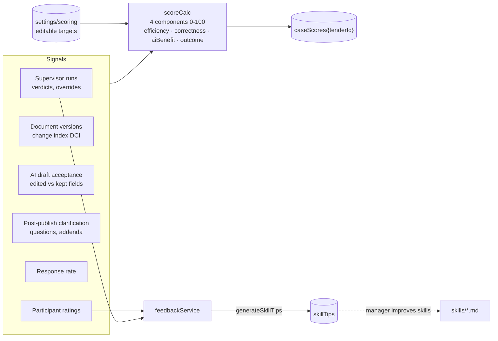

A metric the case cannot yet be measured on is dropped and the remaining weights are rescaled. Scores are recomputed after transitions, document generation and refresh. Feedback is requested from every internal participant at publication (and at award).

---

## 12. Frontend

- **Entry/router** (`web/src/App.tsx`): unauthenticated → `Login`; authenticated without a role → `Unauthorized` (forced sign-out). Suppliers get only `/portal` and `/portal/:id` in `SupplierLayout`. Internal users get `InternalLayout`.
- **Routes (internal)**: `/` MyDesk · `/all` Dashboard · `/requests/new` (requester, manager) · `/requests/:serial` (manager) · `/tenders/:id` workspace · `/suppliers` · and manager-only `/settings` (users, templates, scoring), `/reports`, `/audit`.
- **Workspace** (`TenderWorkspace`): case file, draft panel, document, team/access, approvals, Q&A, evaluation, supervisor, score, feedback, chat.
- **Data access**: one Firebase app in `lib/firebase.ts` (App Check starts first; emulator wiring on `localhost` unless `VITE_USE_EMULATOR=false`). Reads via `onSnapshot` with error callbacks; writes only through `httpsCallable` wrappers in `lib/api.ts`. Never call `initializeApp` elsewhere.
- **Language**: Hebrew only, RTL, i18next (`i18n/he.json`).

---

## 13. Build, environments and deployment

| Environment | How | Notes |
|---|---|---|
| **Local** | `npm run build:shared && npm run build:functions`, then `npx firebase emulators:start` (Auth 9099, Functions 5001, Firestore 8080, Storage 9199, Hosting 5000, UI 4000), `npm run seed`, `npm run dev:web` | AI is off and Docs run in HTML mode unless overridden. Needs Java. On Windows set `FUNCTIONS_DISCOVERY_TIMEOUT=60`. |
| **Live** | `npm run build && npx firebase deploy` (deploy only changed functions) | Web can run locally against live with `VITE_USE_EMULATOR=false`. |

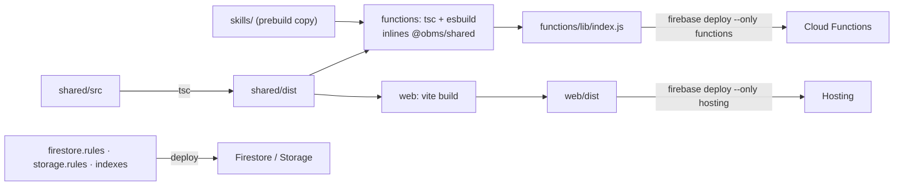

`@obms/shared` is deliberately **absent from `functions/package.json`**: Cloud Build runs `npm install` and would 404 on an unpublished workspace package, so it is bundled in instead.

**Secrets** (Secret Manager, bound per function through `onCall({ secrets })`): `ANTHROPIC_API_KEY`, `GOOGLE_OAUTH_CLIENT_ID`, `GOOGLE_OAUTH_CLIENT_SECRET`, `GOOGLE_OAUTH_REFRESH_TOKEN`. Nothing is committed. Other config via env: model overrides (`ANTHROPIC_*_MODEL`), `STORAGE_BUCKET`, `USE_GOOGLE_DOCS`, `ALLOW_REAL_AI_IN_EMULATOR`, web `VITE_*` (including `VITE_APPCHECK_SITE_KEY`).

**Tests**: node `--test` unit suites in `functions/src/test/` (FSM-adjacent rules, bid number, score, supervisor, templates, XSS, request agent, etc.), a Firestore rules suite, and an emulator end-to-end flow (`e2e.ts`). Live `verify*.mjs` scripts exercise deployed features.

**App Check** rollout is phase 1 of 5 (web initializes it when the site key is set; nothing is enforced yet). Enforcement on callables, Firestore and Storage is phase 4.

---

## 14. Known gaps, risks and documentation drift

| # | Item | Detail |
|---|---|---|
| 1 | **`beforeUserSignedIn` disabled** | Server-side "only registered users" check needs Identity Platform. Only the client guard is live. |
| 2 | **Legacy requirements not rebuilt** | Artifact versioning, per-department review queue, supplier self-registration, notifications (no email or inbox), blind review / A–D anonymization, auto-lock job. See SPEC §9. |
| 3 | **Evaluation reads summaries only** | Uploaded proposal files are never parsed by the AI. |
| 4 | **Reference bids unused** | `templates.examples[]` are links the model cannot open. |
| 5 | **Access is additive** | No `revokeAccess`; only team reassignment revokes internal access. |
| 6 | **No upload type restriction**, no Q&A cutoff or answer notification. | |
| 7 | **Google OAuth durability** | Docs depend on one refresh token. If calls fail, re-run `functions/oauth-bootstrap.mjs`. |
| 8 | **Approvals invoker permission** | `approveTender` once deployed without a public invoker. Code now has `REQUIRE_APPROVALS = true` (commit notes say it became callable on 2026-11-03). Confirm on the live project. |
| 9 | **App Check not enforced** | Scripted clients with a valid login are not yet blocked. |
| 10 | **SPEC.md has drifted** | It says Node 20 (code/`firebase.json`: Node 22), "not under version control" (it is in git), a 7-test baseline, and predates teams, approvals, draft-first, bid numbers, supervisor, scoring and the request agent. Treat this document as newer. |
| 11 | **Hosting status unclear** | SPEC says live at `biding-system.web.app`; developer notes say the web app is run locally. |
| 12 | **Static prototype in repo root** | `index.html`, `supplier.html`, `assets/` are the original mock and are unrelated to the running system. |
| 14 | **Orphaned deployed functions** | `supplierListTenders`, `supplierGetTender`, `createSubmissionUpload`, `migrateComparisonReports` are live but exist in no branch or git history of this repo. They were probably deployed from another copy (SPEC mentions an untracked `bid-system` folder on a Mac). Their behaviour, auth checks and secrets are unknown, and the next deploy from this repo will not update them. Decide: recover the source, or delete them with `firebase functions:delete`. |
| 13 | **Hardcoded web config** | `firebase.ts` embeds the project's web `apiKey`/`appId` as defaults. These are public by design, but they pin the default target to production. |

---

## 15. Open items to complete from the Firebase console

Everything below is not derivable from the repository.

**Project and platform**
- [ ] ❓ Project number, billing plan (Blaze?), default GCP resource location, Firestore database id and location (SPEC: `eur3`), Storage bucket name and location
- [ ] ❓ Hosting: is it deployed, what are the live domains, any custom domain
- [ ] ❓ Environments: is there only one project (`biding-system`) or also staging
- [ ] ❓ Firestore backup / point-in-time recovery and TTL policies, if any

**Authentication**
- [ ] ❓ Enabled sign-in providers (Google, email/password), authorized domains
- [ ] ❓ Identity Platform (GCIP) upgraded? (blocks item 1 in §14)
- [ ] ❓ Number of users per role; how the first manager was bootstrapped

**Functions**
- [x] Deployed functions vs code (checked 2026-11-04 with `firebase functions:list`): 52 deployed, 48 in code. All 48 are deployed. 4 are deployed but have no source in this repo: `supplierListTenders`, `supplierGetTender`, `createSubmissionUpload`, `migrateComparisonReports` (see §14 item 14). All are v2, europe-west1, 1024 MB, nodejs22; `researchOnRequestCreated` is the only non-callable (Firestore onCreate).
- [ ] ❓ Last deploy time per function
- [ ] ❓ IAM invoker setting per callable (especially `approveTender`)
- [ ] ❓ Min instances / concurrency overrides, current runtime (code says Node 22)
- [ ] ❓ Secret Manager: which secrets exist, version numbers, who may access them
- [ ] ❓ Budget alerts and quotas for Anthropic and Google APIs

**Security**
- [ ] ❓ App Check: registered app, reCAPTCHA Enterprise key, current enforcement mode per service (SPEC and RUNNING say not enforced)
- [ ] ❓ Deployed rules version = repo `firestore.rules` / `storage.rules`?
- [ ] ❓ Google OAuth consent screen status (Testing vs In production) and the Google account that owns the Docs
- [ ] ❓ Drive folder (`GOOGLE_DRIVE_PARENT_ID`) used for generated documents

**Data**
- [ ] ❓ Real document counts per collection, and whether the live `templates/*` are the converted, real ones (goods / service / project)
- [ ] ❓ Which exact indexes exist in the console vs `firestore.indexes.json` (any composite index added by hand after an error link)
- [ ] ❓ Monitoring: log-based alerts, error reporting, dashboards

When you send me those answers (or paste console screenshots/exports), I'll fold them into the matching sections and remove the checkboxes.
