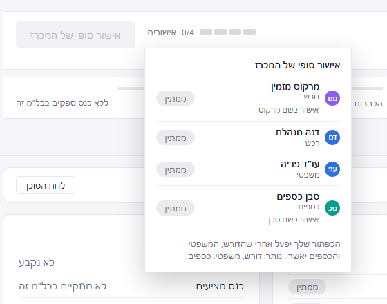
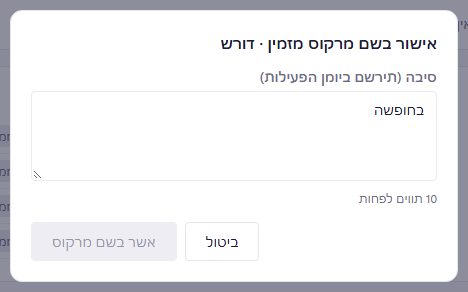
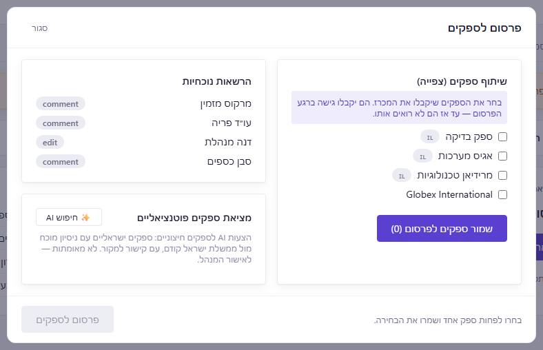

# חבילת בדיקה ל-UX: התאמה לפרוטוטייפ v19

**תאריך:** 05.11.2026 · **ענף:** `feat/prototype-parity` (commit `02cb0c2`) · **פרוטוטייפ:** `docs/blm-prototype 19.html`

## מה נבנה

המסכים של שלבי אפיון עד פרסום נבנו לפי הפרוטוטייפ, על הנתונים האמיתיים של המערכת:

- כותרת המכרז, הכפתור הראשי וסרגל השלבים;
- כרטיס האישורים;
- לשונית סקירה;
- דף הטיוטה והמסמך;
- פאנל הממצאים ולשונית הסוכן המפקח;
- לשוניות פעילות והיסטוריית גרסאות;
- הצ'אט הפנימי;
- דף הבית ("לטיפולך", "מועדים קרובים", "הבל"מים שלי");
- מסך השלמת הבקשה ברכש.

כשהפרוטוטייפ והמסמך `design-specs.md` סותרים, **הפרוטוטייפ קובע** (החלטה מ-04.11.2026).

## מה מבקשים מכם

1. **שני מסכים שאין להם עיצוב בפרוטוטייפ:** אישור בשם משתתף, וחלון הפרסום לספקים. סעיף 1.
2. **טקסטים חדשים** שאינם בפרוטוטייפ. סעיף 2.
3. **שמות סוגי הממצאים** של הסוכן המפקח: 20 שמות שאינם בפרוטוטייפ. אלה צריכים גם בדיקה משפטית. סעיף 3.
4. **שאלות פתוחות.** סעיף 4.

השינויים מהפרוטוטייפ שכבר הוחלטו מרוכזים בסעיף 5, לידיעה.

**איך עונים:** לכל פריט יש מספר (למשל 2.4.3). מספיק לכתוב לפי המספר: "מאושר", או את הנוסח המתוקן. פריט בלי תשובה נשאר כמו שהוא.

**סימונים בטקסטים:** `{שם}`, `{תפקיד}`, `{מספר}` וכדומה הם ערכים שהמערכת ממלאת. `{תאריך}` מוצג כ-05.11 14:30.

---

## 1. שני מסכים בלי עיצוב בפרוטוטייפ

### 1.1 אישור בשם משתתף

**ההחלטה (04.11.2026):** מנהל המכרז יכול לאשר בשם משתתף אחר כשצריך. דרושה סיבה, והאישור נרשם ביומן הפעילות. לפרוטוטייפ אין יכולת כזו, ולכן מה שבנינו הוא הצעה.

**מתי זה זמין:** רק למנהל המכרז, רק לפני האישור הסופי, ורק לתפקיד שיש בו איש קשר משויך. אבטחת מידע לא חוסמת, ולכן אין לה אישור בשם. הסדר נשמר גם כאן: אישור בשם המשפטי מוצע רק אחרי שהדורש והכספים אישרו (בתמונה: יש פעולה לדורש ולכספים, ואין למשפטי).

**איפה זה מתחיל:** בכרטיס האישורים שנפתח מ"אישורים N/4" בכותרת. בשורה של משתתף שעדיין לא אישר מופיעה פעולה שקטה.

| מס' | איפה | הטקסט |
|---|---|---|
| 1.1.1 | פעולה בשורה בכרטיס האישורים | אישור בשם {שם פרטי} |
| 1.1.2 | כותרת החלון | אישור בשם {שם} · {תפקיד} |
| 1.1.3 | תווית השדה | סיבה (תירשם ביומן הפעילות) |
| 1.1.4 | הנחיה מתחת לשדה, כשהסיבה שהוקלדה קצרה מדי (הכפתור כבוי עד אז) | 10 תווים לפחות |
| 1.1.5 | כפתורים | ביטול · אשר בשם {שם פרטי} |
| 1.1.6 | התג בשורה אחרי האישור | אושר בשם |
| 1.1.7 | ריחוף על התג | אושר על ידי {מנהל} בשם {משתתף} · {תאריך} · {סיבה} |
| 1.1.8 | פעולה בשורה אחרי האישור | בטל את האישור בשם {שם פרטי} |
| 1.1.9 | יומן הפעילות | אישור בשם: {מנהל} אישר בשם {משתתף} · {תפקיד} · סיבה: {סיבה} |
| 1.1.10 | יומן הפעילות, ביטול | {מנהל} ביטל את האישור שניתן בשם {תפקיד} |
| 1.1.11 | תפקיד בלי איש קשר: הפעולה "אישור בשם" כבויה, ובריחוף עליה | יש לשייך איש קשר לפני אישור בשמו |

**שאלות:**

- **1.1.A** האם הפעולה צריכה להיות בכרטיס האישורים, או במקום אחר?
- **1.1.B** האם 10 תווים הם מינימום סביר לסיבה?
- **1.1.C** האם המשתתף שאושר בשמו צריך לקבל הודעה? היום אין הודעה, רק רישום ביומן.

### 1.2 פרסום לספקים

**ההחלטה (D8, זמנית):** בפרוטוטייפ הכפתור בשלב "פרסום" רק פותח את המסמך, ואין בשום מקום בחירה של ספקים. בנינו חלון שנפתח מהכפתור הראשי ("אישור סופי ופרסום לספקים ←"), ובו בוחרים את הספקים ומפרסמים.

**מה בתוך החלון:** פאנל הגישה שכבר קיים במערכת, כמו שהוא היום: "שיתוף ספקים (צפייה)", "הרשאות נוכחיות" ו"מציאת ספקים פוטנציאליים". הטקסטים שלו אינם חדשים ואינם בטבלה. הפרסום הוא בשני צעדים: "שמור ספקים לפרסום ({N})", ואז "פרסום לספקים".

| מס' | איפה | הטקסט |
|---|---|---|
| 1.2.1 | כותרת החלון וכפתור הפרסום | פרסום לספקים |
| 1.2.2 | הנחיה, כשנבחרו ספקים | הספקים שנבחרו יקבלו גישה למסמך עם הפרסום. |
| 1.2.3 | הנחיה, כשלא נבחר ספק (הכפתור כבוי) | בחרו לפחות ספק אחד ושמרו את הבחירה. |

**שאלות:**

- **1.2.A** בחירת הספקים בתוך החלון היא רכיב קיים מהמערכת, ולא עוצבה מחדש. האם לעצב אותה?
- **1.2.B** האם צריך שלב אישור נוסף ("לפרסם ל-3 ספקים?") לפני הפרסום?
- **1.2.C** "הרשאות נוכחיות" מציג את ההרשאות של צוות המכרז, ושמות ההרשאות מופיעים באנגלית ("comment", "edit"). האם להסיר את החלק הזה מחלון הפרסום? אם נשאר, אילו שמות בעברית?
- **1.2.D** האם לאחד את שני הצעדים (שמירת הבחירה ופרסום) לכפתור אחד?

---

## 2. טקסטים חדשים

טקסטים שהמערכת מציגה ואינם מופיעים בפרוטוטייפ. טקסטים שהועתקו מהפרוטוטייפ כלשונם אינם ברשימה.

### 2.1 הכפתור הראשי בכותרת

| מס' | מתי | הטקסט |
|---|---|---|
| 2.1.1 | ריחוף על כפתור כבוי של הרכש, כשחסרים אישורים | הכפתור שלך יפעל אחרי שהדורש, המשפטי והכספים יאשרו. נותר: {תפקידים}. |
| 2.1.2 | ריחוף על כפתור כבוי של המשפטי | הכפתור שלך יפעל אחרי שהדורש והכספים יאשרו. נותר: {תפקידים}. |
| 2.1.3 | ריחוף על "יצירת מסמך" אצל מי שאינו מהרכש | רק הרכש יכול ליצור את המסמך |
| 2.1.4 | ריחוף על "יצירת מסמך" כשנשארו אזהרות | שימו לב: יש ממצא אחד שלא הוטמע, ועדיין אפשר ליצור את המסמך |
| 2.1.5 | אותו מצב, כמה ממצאים | שימו לב: יש {N} ממצאים שלא הוטמעו, ועדיין אפשר ליצור את המסמך |

### 2.2 כרטיס האישורים

| מס' | מתי | הטקסט |
|---|---|---|
| 2.2.1 | הערה לרכש, כשכולם אישרו | כולם אישרו. לחץ על "אישור סופי של המכרז" כדי לנעול את המסמך. |
| 2.2.2 | הערה למשפטי, כשהדורש והכספים אישרו | הדורש והכספים אישרו. אחרי האישור שלך הרכש יוכל לתת אישור סופי. |
| 2.2.3 | כרטיס "הרביעייה" בסקירה, תפקיד בלי איש קשר | לא משובץ |
| 2.2.4 | "לטיפולך" של אבטחת מידע, כשמבקשים ממנה איש קשר | בל"מ חדש ממתין לאיש קשר מטעם **גוף אבטחת המידע** |
| 2.2.5 | אישור לפני פתיחה מחדש | לפתוח מחדש? ייווצר עותק חדש של המסמך לעריכה, האישורים יתאפסו והמסמך הנעול יישמר. |

### 2.3 "לטיפולך" בדף הבית

| מס' | מתי | הטקסט |
|---|---|---|
| 2.3.1 | לרכש, כשכל הצוות אישר | **כל הצוות אישר:** ממתין לאישור הסופי שלך |
| 2.3.2 | למשתתף, כשהמסמך נוצר | **אישור סופי של המכרז:** המסמך מוכן לאישורך |
| 2.3.3 | כשאין פריטים | אין כרגע פריטים לטיפולך. |

### 2.4 הטיוטה והמסמך

| מס' | מתי | הטקסט |
|---|---|---|
| 2.4.1 | באנר מעל דף הטיוטה, לפני יצירת המסמך | המסמך עדיין לא נוצר. כך ייראה המסמך מנתוני הטיוטה — שדות ריקים מסומנים בצהוב. |
| 2.4.2 | באנר, בזמן שהסוכן בודק | הסוכן המפקח בודק את הטיוטה… אפשר לקרוא בינתיים |
| 2.4.3 | באנר, לפני הבדיקה הראשונה | הטיוטה טרם נבדקה |
| 2.4.4 | באנר, כשהטיוטה השתנתה מאז הבדיקה | הטיוטה השתנתה מאז הבדיקה — הממצאים עשויים להיות לא עדכניים. |
| 2.4.5 | כפתור בפאנל הממצאים | הטמע הכול ({N}) והרץ בדיקה |
| 2.4.6 | כפתור בממצא חוסם (במקום "הטמע") | ערוך שדה |
| 2.4.7 | שדה חובה ריק במסמך שנוצר | __________ (להשלמה: {שם השדה}) |
| 2.4.8 | מסמך שנוצר ועוד לא אושר סופית | המסמך טרם אושר סופית. אפשר ליצור אותו מחדש מנתוני הטיוטה המעודכנים. |
| 2.4.9 | מסמך אחרי האישור הסופי | המסמך נעול לאחר האישור הסופי. רק מנהל המכרז יכול לפתוח אותו מחדש. |
| 2.4.10 | ריחוף על כלים בסרגל המסמך | הקטנה · הגדלה · התאמה לרוחב · הדפסה |
| 2.4.11 | שדה החיפוש בסרגל המסמך | חיפוש במסמך |
| 2.4.12 | ריחוף על כלים שעוד לא פועלים | {שם הכלי} — בקרוב (רשימה, הדגשה, סימון, מחיקה, טקסט, סיבוב, תצוגת עמודים, שמירה, הגדרות) |

### 2.5 הסוכן המפקח

| מס' | מתי | הטקסט |
|---|---|---|
| 2.5.1 | פאנל הממצאים ולשונית הסוכן, לפני בדיקה של המסמך | הסוכן טרם בדק את המסמך. |
| 2.5.2 | שורת המצב בסקירה, אותו מצב | הסוכן המפקח טרם בדק את המסמך |
| 2.5.3 | כפתור בלשונית הסוכן | הרץ סוכן מפקח על המסמך |
| 2.5.4 | תגיות בלשונית הסוכן | ללא מקור · מידע · {N} חסרות (מיומנויות) |
| 2.5.5 | הודעה כשמישהו מפעיל בדיקה בזמן שבדיקה אחרת רצה | הסוכן המפקח כבר בודק את המכרז. |
| 2.5.6 | ממצא שמרכז את כל שדות החובה הריקים | שדות חובה שטרם הושלמו במסמך: {שדות} (ועוד) |

**"הצעת הסוכן"**: הנוסח שמוצג בממצא שהסוכן לא ניסח לו הצעה בעצמו.

| מס' | סוג הממצא | הצעת הסוכן |
|---|---|---|
| 2.5.7 | מידע חסר | להשלים את השדות בנתוני הטיוטה, או להשאיר אותם כקו ריק להשלמה במסמך. |
| 2.5.8 | חשיפת מידע חסוי | להסיר את הערך החסוי (אומדן או תקציב) ולהשאיר ניסוח כללי. |
| 2.5.9 | תבנית לא תואמת | ליצור את המסמך מהתבנית של סוג הבל"מ. |
| 2.5.10 | התבנית השתנתה · מסמך התבנית השתנה | לבדוק את המסמך מול הנוסח העדכני של התבנית. |
| 2.5.11 | מבנה התבנית חסר | להחזיר את המבנה כפי שהוא בתבנית. |
| 2.5.12 | סעיף מתבנית אחרת | להסיר את הסעיף שאינו שייך לסוג הבל"מ. |
| 2.5.13 | מיומנות חסרה | להפיק מחדש את טיוטת ה-AI כדי שתכלול את המיומנות. |
| 2.5.14 | גרסת מיומנות השתנתה | להפיק מחדש את טיוטת ה-AI לפי הגרסה העדכנית של המיומנות. |
| 2.5.15 | אין טיוטת AI | להפיק את טיוטת ה-AI לפני יצירת המסמך. |
| 2.5.16 | טיוטת ה-AI נכשלה | להפיק מחדש את טיוטת ה-AI. |
| 2.5.17 | ערך לא תקין | לתקן את הערך בשדה. |
| 2.5.18 | ערך חסר במסמך | לוודא שהערך מופיע במסמך. |
| 2.5.19 | שדה ללא מקור · ערך ללא מקור | לעדכן את הערך מנתוני הבקשה או לציין את מקורו. |
| 2.5.20 | סתירה | ליישר את הערכים כך שיתאימו זה לזה. |
| 2.5.21 | משקלי הערכה שגויים | לעדכן את משקלי ההערכה כך שיסתכמו ל-100. |
| 2.5.22 | סעיף חובה חסר | להוסיף את הסעיף מנוסח התבנית. |
| 2.5.23 | סעיף משפטי חסר | להוסיף את הסעיף המשפטי מנוסח התבנית. |
| 2.5.24 | סעיף משפטי שונה | להחזיר את הנוסח המשפטי כלשונו מהתבנית. |
| 2.5.25 | רכיב משפטי חסר | להוסיף את הרכיב המשפטי מנוסח התבנית. |
| 2.5.26 | דרישה מצמצמת תחרות | לשקול ניסוח רחב יותר של הדרישה. |
| 2.5.27 | המסמך לא נקרא | לבדוק את הגישה למסמך ולהריץ את הבדיקה שוב. |
| 2.5.28 | בדיקת ה-AI לא בוצעה · הסוכן המפקח לא זמין | להריץ את הבדיקה שוב. |

### 2.6 לשונית פעילות

משפטים שנבנים מיומן הפעילות. `{מי}` הוא שם האדם שפעל.

| מס' | האירוע | הטקסט |
|---|---|---|
| 2.6.1 | יצירת המכרז | {מי} יצר את הבל"מ |
| 2.6.2 | יצירת המסמך | {מי} יצר את המסמך מהטיוטה |
| 2.6.3 | יצירת המסמך מחדש | {מי} יצר מחדש את המסמך מנתוני הטיוטה |
| 2.6.4 | עריכת הטיוטה | {מי} עדכן בטיוטה: {שדות} (ועוד {N}) · או: {מי} עדכן את הטיוטה |
| 2.6.5 | בדיקת הסוכן | הסוכן המפקח בדק: {N} ממצאים, מהם {N} חוסמים · או: …, אין ממצא חוסם |
| 2.6.6 | פרסום בחריגה | {מי} פרסם בחריגה מתועדת מעל חסימת הסוכן המפקח: {סיבה} |
| 2.6.7 | ממצאים שנשארו | {מי} השאיר {N} ממצאים כמו שהם |
| 2.6.8 | אישור של משתתף (הנוסח מהפרוטוטייפ, ראו שאלה 4.3) | אישור סופי: {מי} · {תפקיד} |
| 2.6.9 | האישור הסופי של הרכש | אישור סופי: {מי} · רכש. המכרז ננעל ומוכן לפרסום |
| 2.6.10 | פתיחה מחדש | {מי} פתח מחדש: נוצרה גרסה חדשה מקושרת. המקור נשאר נעול |
| 2.6.11 | שיוך לתפקיד | {מי} שייך את {שם} לתפקיד {תפקיד} · ואם שייך את עצמו: שיוך לתפקיד {תפקיד}: {שם} |
| 2.6.12 | הסרה מתפקיד | {מי} הסיר את השיבוץ של {תפקיד} |
| 2.6.13 | בחירת ספקים | {מי} בחר ספקים לפרסום ({N} ספקים) |
| 2.6.14 | פרסום | {מי} פרסם את הבל"מ לספקים |
| 2.6.15 | הצעה ראשונה | התקבלה הצעה ראשונה: הבל"מ עבר לשלב ההצעות |
| 2.6.16 | השוואת הצעות | {מי} הפעיל את השוואת ההצעות |
| 2.6.17 | זכייה | {מי} הכריז על זוכה |
| 2.6.18 | אין עדיין פעילות | עדיין אין פעילות בבל"מ הזה. |

### 2.7 היסטוריית גרסאות

| מס' | מתי | הטקסט |
|---|---|---|
| 2.7.1 | תיאור הגרסה הראשונה | המסמך נוצר מהטיוטה |
| 2.7.2 | תיאור גרסה | שונתה פסקה אחת · שונו {N} פסקאות · ללא שינוי בטקסט |
| 2.7.3 | תיאור גרסה, עם מקום השינוי | {מה השתנה} · {סעיפים} (ועוד) |
| 2.7.4 | כותרת התצוגה | גרסה v{N} · v{N} לעומת הגרסה הנוכחית |
| 2.7.5 | בהשוואה, קטע שלא השתנה | {N} פסקאות ללא שינוי |
| 2.7.6 | השוואה בלי הבדלים | אין הבדלים בטקסט. |
| 2.7.7 | כשאין עדיין גרסאות | הגרסאות נשמרות מרגע יצירת המסמך. |

### 2.8 דף הבית

| מס' | מתי | הטקסט |
|---|---|---|
| 2.8.1 | "מועדים קרובים", כשאין תאריך לשלב הבא | טרם נקבע |
| 2.8.2 | "מועדים קרובים", כשאין מכרזים פעילים | אין כרגע בל"מים פעילים. |

### 2.9 הודעות שגיאה

מוצגות כשפעולה נדחית. רובן לא אמורות להופיע בשימוש רגיל, כי הכפתור כבוי מראש.

| מס' | מתי | הטקסט |
|---|---|---|
| 2.9.1 | אישור, למי שלא משובץ | אינך משובץ בתפקיד שנדרש לאשר את המכרז. |
| 2.9.2 | אישור, בתפקיד שלא נדרש | התפקיד אינו נדרש לאישור במכרז זה. |
| 2.9.3 | אישור לפני שנוצר מסמך, או אחרי הנעילה | ניתן לאשר רק אחרי שהמסמך נוצר ולפני האישור הסופי. |
| 2.9.4 | המשפטי מאשר מוקדם | המשפטי מאשר אחרי שהדורש והכספים אישרו. |
| 2.9.5 | אישור כשיש ממצא חוסם | ממצא חוסם מונע אישור סופי ופרסום. |
| 2.9.6 | אישור סופי לפני שנוצר מסמך | יש ליצור את מסמך המכרז לפני האישור הסופי. |
| 2.9.7 | אישור בשם, בלי סיבה | יש לציין סיבה (10 תווים לפחות) לאישור בשם משתתף. |
| 2.9.8 | אישור בשם, למי שאינו מנהל המכרז | רק מנהל המכרז יכול לאשר בשם משתתף. |
| 2.9.9 | אישור בשם התפקיד של עצמי | את התפקיד שלך מאשרים בכפתור הראשי. |
| 2.9.10 | ביטול בשם משתתף של אישור שהוא נתן בעצמו | אפשר לבטל בשם משתתף רק אישור שניתן בשמו. |
| 2.9.11 | שיוך איש קשר מיחידה אחרת | אפשר לשייך איש קשר רק מטעם היחידה שלך. · איש הקשר חייב להיות מאותה יחידה. |
| 2.9.12 | שיוך, כשהמכרז לא ביקש מהיחידה | המכרז לא ביקש איש קשר מהיחידה שלך. |
| 2.9.13 | שיוך, כשכבר שויך | כבר שויך איש קשר מהיחידה שלך למכרז זה. |
| 2.9.14 | החלטה על ממצא שכבר לא קיים | הממצא אינו בבדיקה האחרונה. יש לרענן את הדף. |
| 2.9.15 | "השאר כמו שהוא" על ממצא חוסם | ממצא חוסם מטופל בתיקון, לא בסימון. |
| 2.9.16 | החלטה על ממצא אחרי הפרסום | ניתן להחליט על ממצאים רק לפני הפרסום. |
| 2.9.17 | החלטה על ממצא לפני בדיקה | הסוכן המפקח טרם בדק את המכרז. |
| 2.9.18 | יצירת מסמך מחדש אחרי הנעילה | ניתן ליצור מסמך מחדש רק לפני האישור הסופי. |
| 2.9.19 | פתיחה מחדש של מסמך שלא ננעל | ניתן לפתוח מחדש רק מסמך נעול, לפני הפרסום לספקים. |
| 2.9.20 | פרסום בלי מועד הגשה | יש לקבוע מועד הגשת הצעות לפני הפרסום לספקים. |
| 2.9.21 | גרסה שלא נמצאה | הגרסה לא נמצאה. |
| 2.9.22 | בחירת זוכה לפני השוואת ההצעות | ניתן לבחור זוכה רק לאחר השוואת ההצעות. |
| 2.9.23 | בחירת זוכה שלא הגיש הצעה | הספק לא הגיש הצעה במכרז הזה. |
| 2.9.24 | בחירת זוכה פעם שנייה | כבר נבחר זוכה במכרז הזה. |
| 2.9.25 | ניסיון לקבוע ידנית את שלב ההצעות | שלב ההצעות מתחיל מעצמו עם ההגשה הראשונה של ספק. |
| 2.9.26 | ניסיון לקבוע ידנית את שלב ההערכה | שלב ההערכה מתחיל בהרצת השוואת ההצעות. |
| 2.9.27 | ניסיון לקבוע ידנית זכייה | הזכייה נקבעת בבחירת הספק הזוכה. |
| 2.9.28 | מעבר שלב לא חוקי | מעבר סטטוס לא חוקי: {from} → {to} (ראו שאלה 4.5) |

---

## 3. שמות סוגי הממצאים

הסוכן המפקח מסווג כל ממצא לאחד מ-26 סוגים. הפרוטוטייפ נותן שם רק לשישה מהם (שורה 2519). לשאר הצענו שמות. **השמות צריכים גם בדיקה משפטית.**

**מהפרוטוטייפ (לידיעה):** חשיפת מידע חסוי · מידע חסר · סתירה · סעיף חובה חסר · דרישה מצמצמת תחרות · רכיב משפטי חסר.

| מס' | השם המוצע | מה זה אומר |
|---|---|---|
| 3.1 | מקור התבנית לא תועד | לא נשמר מאיזו תבנית ובאילו מיומנויות נוצר המכרז |
| 3.2 | תבנית לא תואמת | המסמך, או טיוטת ה-AI, נוצרו לסוג בל"מ אחר מסוג המכרז |
| 3.3 | התבנית השתנתה | התבנית עודכנה אחרי שהמכרז נוצר |
| 3.4 | מסמך התבנית השתנה | קובץ התבנית ב-Google Docs הוחלף אחרי שהמכרז נוצר |
| 3.5 | מבנה התבנית חסר | פחות ממחצית מהטקסט הקבוע של התבנית נמצא במסמך |
| 3.6 | סעיף מתבנית אחרת | במסמך יש תוכן ששייך לסוג בל"מ אחר |
| 3.7 | מיומנות חסרה | מיומנות שנדרשת לסוג הבל"מ לא הופעלה בכתיבת הטיוטה |
| 3.8 | גרסת מיומנות השתנתה | מיומנות עודכנה אחרי שהטיוטה נכתבה |
| 3.9 | אין טיוטת AI | המכרז הוזן ידנית, בלי טיוטת AI |
| 3.10 | טיוטת ה-AI נכשלה | כתיבת הטיוטה על ידי ה-AI נכשלה, והערכים הוזנו בלעדיה |
| 3.11 | ערך לא תקין | בשדה מספרי יש ערך שאינו מספר |
| 3.12 | ערך חסר במסמך | ערך שנשמר במכרז לא מופיע במסמך (ייתכן שהמסמך נערך) |
| 3.13 | שדה ללא מקור | ה-AI מילא שדה בלי לציין מאיפה הערך |
| 3.14 | ערך ללא מקור | מספר שה-AI הכניס, ואינו מופיע בבקשה או בתבנית |
| 3.15 | משקלי הערכה שגויים | משקלי אמות המידה לא מסתכמים ל-100 |
| 3.16 | סעיף משפטי חסר | סעיף חובה משפטי לא נמצא במסמך |
| 3.17 | סעיף משפטי שונה | נוסח של סעיף חובה משפטי שונה מהתבנית |
| 3.18 | המסמך לא נקרא | לא הצלחנו לקרוא את המסמך כדי לבדוק אותו |
| 3.19 | בדיקת ה-AI לא בוצעה | בדיקת ה-AI לא הופעלה (בסביבת בדיקות) |
| 3.20 | הסוכן המפקח לא זמין | בדיקת ה-AI נכשלה. בפרסום זה חוסם עד בדיקה חוזרת או אישור חריגה |

---

## 4. שאלות פתוחות

- **4.1 משך הבדיקה.** הטקסט "זה לוקח כמה שניות" (מהפרוטוטייפ) מבטיח פחות ממה שקורה: בדיקה אמיתית לוקחת לפעמים עד דקה. להשאיר, או לשנות ל"זה עשוי לקחת עד דקה"?
- **4.2 טעות דקדוק בפרוטוטייפ.** בפרוטוטייפ כתוב "יש ממצא אחד שלא הוטמעו" (שורה 2608). אצלנו: "שלא הוטמע". לאשר.
- **4.3 שתי פעולות באותו שם.** האישור של כל משתתף נקרא "אישור סופי של המכרז", וגם האישור של הרכש שנועל את המסמך נקרא "אישור סופי". כך גם ביומן הפעילות (2.6.8 ו-2.6.9). זה כמו בפרוטוטייפ. האם להבדיל ביניהם, למשל "אישור" למשתתף ו"אישור סופי" לרכש?
- **4.4 פנייה בלשון זכר יחיד.** "כולם אישרו. לחץ על…" (2.2.1) כתוב בלשון זכר, וברוב המערכת הפנייה ברבים ("בחרו", "שמרו"). לשנות ל"לחצו"?
- **4.5 קודים באנגלית בהודעה.** "מעבר סטטוס לא חוקי: draft → published" (2.9.28) מציג את שמות השלבים באנגלית. ההצעה: להציג את שמות השלבים בעברית ("מעבר לא חוקי: עריכה ← פרסום"), או הודעה כללית. ההודעה לא אמורה להופיע בשימוש רגיל.
- **4.6 אבטחת מידע.** "גוף אבטחת המידע" (2.2.4) הוא שם חדש. הפרוטוטייפ מבקש איש קשר רק מהיחידה המשפטית ומגוף הכספים.

---

## 5. שינויים מהפרוטוטייפ שכבר הוחלטו (לידיעה)

**כללי**

- פינות של 4px כמו בפרוטוטייפ, חוץ מפאנלים צדדיים (12px), תגיות ותמונות פרופיל (עגולים).
- כפתור כבוי עדיין מציג בריחוף למה הוא כבוי. בפרוטוטייפ הריחוף חסום.
- טקסט הכפתורים במשקל רגיל, כמו בפרוטוטייפ.

**מכרז**

- לשוניות "שיתוף והרשאות" ו"תיק מכרז" מוסתרות. הספקים נבחרים בחלון הפרסום (1.2).
- אבטחת מידע מאשרת כמשתתף נוסף ולא חוסמת את האישור הסופי.
- ממצא חוסם אי אפשר "להטמיע" או "להשאיר כמו שהוא". הוא נעלם רק כשבדיקה חוזרת לא מוצאת אותו, ולכן מוצג בו "ערוך שדה" (2.4.6).
- בטיוטה, כל השדות הריקים מרוכזים בממצא אחד: "מידע חסר".
- דף הטיוטה מציג את הנוסח האמיתי של התבנית, לא את הסעיפים לדוגמה של הפרוטוטייפ.
- היסטוריית גרסאות: אין "שחזר". גרסה נשמרת בכל בדיקה של הסוכן, ולכן כמה עריכות ב-Google Docs בין שתי בדיקות נראות כגרסה אחת.
- יומן הפעילות לא מקשר לסעיף במסמך, כי היומן לא שומר את הסעיף.

**צ'אט פנימי**

- הכפתור הצף נמצא 24px מתחתית המסך. בפרוטוטייפ הוא גבוה יותר כדי לא להסתיר את סרגל ההדגמה, שאין במערכת.
- Shift+Enter מוסיף שורה.
- אין צ'אט במסך השלמת הבקשה, כי המכרז והצ'אט שלו עוד לא קיימים.

**דף הבית**

- **אין רצועת מדדים ואין שורת תפקיד מתחת לברכה.** הפרוטוטייפ מגדיר את הנתונים לשניהם אבל לא מציג אותם בדף הבית.
- "מועדים קרובים": התאריך האמיתי היחיד הוא מועד הגשת ההצעות. לשאר השלבים אין תאריך יעד במערכת, ולכן מוצג "טרם נקבע".
- "מועדים קרובים": הקישור "כל המועדים" לא מוצג, כי מסך לוח הזמנים עוד לא נבנה.
- "רביעייה" בטבלה ובכרטיסים מציג את האישורים על המסמך, כמו בכותרת המכרז. בפרוטוטייפ התפקידים משתנים לפי השלב.
- "עדכון אחרון" מציג "מי · מה" רק לבקשות. למכרזים נשמר רק זמן העדכון, ובפרוטוטייפ זה מידע לדוגמה.
- בכרטיסים של משתתפים שאינם מהרכש לא מוצג שם מנהל המכרז, כי אין להם גישה לרשימת המשתמשים.

**מסך השלמת הבקשה**

- בכרטיס של הדורש אין שם יחידה (אין נתון כזה במערכת), ואין "פנייה בצ'אט".
- "בקשת משתתף נוסף מגוף" מוסתר, כי אין לזה עדיין תמיכה במערכת.
